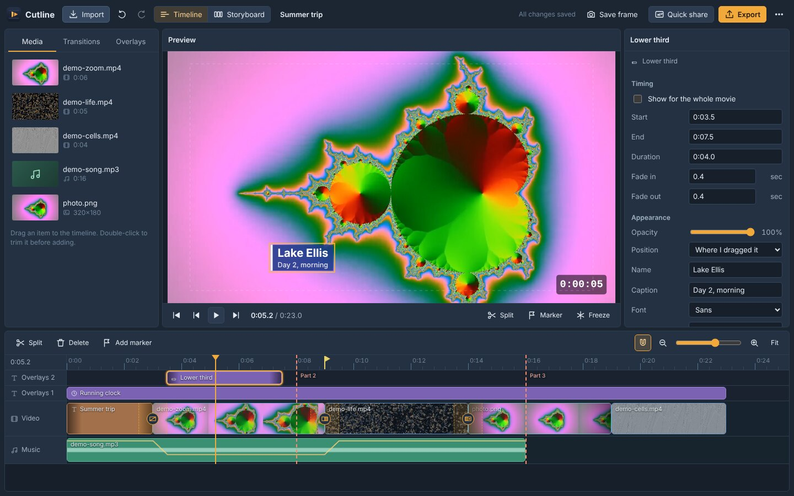

# Cutline

A desktop video editor that runs entirely in the browser, with the drag-and-drop feel of Windows XP Movie Maker. It's a static site: no server, no uploads. Everything happens on your computer, and it keeps working offline once it has loaded.

The headline feature is **splitting a finished movie into fixed-length parts** (every _N_ seconds) and downloading them as one zip, with an optional running clock that stays continuous across the parts.



## Features

**Importing**
- Drag files anywhere onto the window, or use **Import**. Items show up in the workspace right away, with a progress ring while they're read or converted.
- Video, music, photos and `.srt` subtitles. The browser plays most formats directly (MP4, WebM, MOV, MKV, MP3, M4A, WAV, Ogg, FLAC, JPEG, PNG, WebP, AVIF…). HEIC photos are decoded with a small HEIC decoder; anything else (AVI, WMV, FLV, MPEG, TIFF…) is converted with a bundled copy of FFmpeg compiled to WebAssembly. Conversions produce high-quality intermediates (H.264 at CRF 17, FLAC, PNG) so quality isn't lost twice.
- **Scene detection**: long videos offer to split into scenes, grouped under the original file in the workspace.
- **Trim before adding**: double-click a workspace item to open it in the preview, set **In** / **Out** (`I` / `O`), then *Add selection to movie* or *Save as clip*.

**Editing**
- Timeline with an **Overlays** track (extra lanes appear automatically when overlays overlap; lane order is stacking order), a **Video** track and a **Music** track.
- Drag clips to move them. They snap to clip edges, markers, the playhead and the start of the timeline (hold **Alt** to drop freely). Dropping onto a clip moves to its nearer edge and pushes later clips right.
- Drag either edge of a clip to trim it. Click to select, **Shift**/**Ctrl**-click or drag a box to select several.
- Delete closes the gap; **Shift+Delete** leaves it.
- Right-click anything for a short menu: split, freeze frame, fades, mute, detach audio, bring to front/send to back, duplicate, delete. Everything in a menu is also in the **Properties** panel.
- **Storyboard view**: the video track as big thumbnails with transition slots between them; drag to reorder.
- **Transitions**: cross-fade, fade through black and wipe, dropped on the seam between two touching clips (1 second by default).
- **Title cards**, **freeze frames** (3 seconds) and **markers** (`M`).
- Photos last 5 seconds and fade in and out by default.
- Undo and redo every edit (`Ctrl+Z`, `Ctrl+Y` or `Ctrl+Shift+Z`).

**Overlays** (drag them into place directly in the preview)
- **Running clock** in `H:MM:SS`, starting at 0:00:00 and counting movie time, so part 2 of a 30-second split opens at 0:00:30. Optional start value and per-part restart.
- **Part indicator** ("Part 2 of 6"), filled in on each exported part.
- **Image / logo**, **text label**, **lower third**, **shape / arrow**, **blur or pixelate box**, **subtitles** from `.srt`, and a camcorder-style **date stamp** taken from each video's recording date (or a date you enter).
- Corner overlays each default to a different corner. The preview shows a safe-zone guide and flags overlapping overlays.

**Sound**
- Per-clip volume (0–200%), mute and fades.
- **Music dims** to 25% (adjustable) while a video clip with sound plays, easing over half a second. The dip is drawn on the music clip's waveform.
- **Detach audio** moves a video's sound to the music track as its own clip.
- **Even out volume** brings clips recorded on different devices to a similar loudness.

**Exporting**
- **Single file** or **Split every _N_ seconds**. Parts are cut exactly at the period (hard cuts), each starts on a keyframe, and they're named by time range: `movie_part02_0030-0100.mp4`. Split lines show on the timeline while splitting is on.
- MP4 (H.264) or WebM (VP9); *Same as source*, 720p, 1080p or 4K; Standard or High quality. A live estimate shows the number of parts and their size.
- Writes straight to disk through the save dialog where the browser supports it, keeps the screen awake, warns before you close the tab, and notifies you when it's done.
- **Quick share**: a silent, looping GIF under 10 MB for GitHub issues and READMEs, from the selected clips, the range between two markers, or the whole movie. Width steps down (800 → 640 → 480 → 360 → 240 px) until it fits, with a warning before going below 480 px where text gets hard to read.
- **Save frame** saves the current frame as a PNG.

**Projects and storage**
- Autosaves continuously. Media is copied into the browser's private file storage (OPFS) so a project reopens with its files after a restart.
- **Save a copy** downloads the project as a `.cutline.json` file; **Open project file** loads one. Missing media gets a **Relink** button.
- Movie settings shows how much space is used, asks the browser to keep your files, offers to clean up media nothing uses any more, and can download the format converter for offline use.

## Using it

Open the hosted site in **Chrome or Edge on a desktop or laptop**. To install it as an app, use the install icon at the right end of the address bar. Installed, it runs in its own window, works offline and can open video, audio and image files from your file manager.

### Keyboard shortcuts

| Action | Keys |
| --- | --- |
| Play / pause | `Space` |
| Undo / redo | `Ctrl+Z` / `Ctrl+Y` or `Ctrl+Shift+Z` |
| Split at playhead | `S` |
| Delete (close gap / leave gap) | `Delete` / `Shift+Delete` |
| Add marker | `M` |
| Step one frame / one second | `←` `→` / `Shift+←` `Shift+→` |
| Go to start / end | `Home` / `End` |
| Set source In / Out (while trimming) | `I` / `O` |
| Duplicate / select all | `Ctrl+D` / `Ctrl+A` |
| Zoom timeline | `Ctrl`+scroll, `+` / `−` |
| Snap off while dragging | hold `Alt` |

On a Mac, use `⌘` instead of `Ctrl`.

## Run it locally

There's no build step. Any static file server works; one is included:

```bash
npm start          # http://localhost:8080
```

Opening `index.html` straight from disk (`file://`) won't work, because browsers block ES modules and offline support there.

## Deploy to GitHub Pages

1. Create a repository on GitHub and push this folder to its `main` branch.
2. In the repository, open **Settings → Pages** and set **Source** to **GitHub Actions**.
3. The **CI** workflow runs the tests on every push, and on `main` it deploys the site. It will be at `https://<your-user>.github.io/<repository>/`.

The deploy step copies only the app files into `_site/` and stamps the service worker's cache version with a hash of those files, so installed copies update whenever the app changes. Users see a **Reload** prompt for the new version, so an edit in progress is never interrupted.

Cutline doesn't need any special server headers, which is why it runs on GitHub Pages as-is: the converter uses the single-threaded FFmpeg build, which doesn't require cross-origin isolation.

> **Deploying from a branch instead?** (Settings → Pages → *Deploy from a branch*) That works too, since `index.html` is at the root. Run `node scripts/stamp-sw.mjs` and commit the result whenever you change app files, or installed copies will keep the old version.

## Tests

```bash
npm ci                              # dev dependency: Playwright test runner
npm test                            # unit tests + offline-cache check (Node 22+, no browser)
npx playwright install chromium     # once
npm run test:e2e                    # browser tests
```

- **Unit tests** (`tests/unit/`) cover the editing model: placing, snapping, pushing, trimming, splitting and deleting clips; overlay lanes; transitions and what gets drawn at each moment; split points and file names; the running clock format; music dimming curves; GIF size planning; scene detection; SRT parsing; and reading recording dates from MP4 files.
- **The offline-cache check** (`scripts/check-precache.mjs`) fails if a file the app needs isn't in the service worker's precache list, or if any import points at a missing file.
- **Browser tests** (`tests/e2e/`) drive the real app in Chromium: importing every media kind, dropping one or several files from the desktop onto the workspace, timeline and storyboard, editing on the timeline, storyboard reordering, overlays and preview dragging, music dimming in the exported mix, split export to a zip, single MP4 and WebM export, Quick share GIFs, reloading with the project intact, working offline, and converting an AVI with the bundled FFmpeg.

To use a Chromium or Chrome you already have, set `CHROMIUM_PATH=/path/to/chrome`.

## How it's built

Plain ES modules, no framework and no bundler.

```
index.html, manifest.webmanifest, sw.js   page, install manifest, offline service worker
css/app.css                               all styles
js/core/      pure editing logic, unit-tested in Node (timeline ops, render plan, audio envelopes,
              split planning, GIF planning, SRT, scene detection, MP4 date parsing)
js/engine/    browser work: import and conversion, OPFS storage, preview playback,
              frame compositor, frame-accurate rendering, export, GIF, scene sampling
js/ui/        panels: toolbar, workspace, preview, properties, timeline, storyboard, dialogs
js/store.js   project state, undo history, selection and events
js/actions.js editing commands shared by menus, shortcuts and drag and drop
vendor/       muxers, zip, GIF encoder, HEIC decoder, FFmpeg (see vendor/licenses)
tests/        unit tests, browser tests and small media fixtures
scripts/      dev server, precache check, service-worker version stamp
```

A few design decisions worth knowing:

- **One renderer for everything.** `js/core/render-plan.js` decides what's visible at a time (clips, transition progress, overlays in lane order) and `js/engine/compositor.js` draws it. The preview, exported frames, GIF frames and saved stills all go through the same code, so what you see is what you export.
- **Export is frame-accurate.** Each frame seeks its video elements to the exact source time before drawing, then frames go through WebCodecs (`VideoEncoder`/`AudioEncoder`) into MP4 or WebM. Sound is mixed per part with an `OfflineAudioContext` using the same fade and dimming curves as the preview.
- **Media stays on disk.** Imported files are streamed into OPFS. Only thumbnails, waveform peaks and a few decoded frames stay in memory, which keeps memory use modest for typical projects whatever their length.
- **Undo is snapshot-based.** The project is small JSON (media bytes live elsewhere), so each edit stores the previous project state.

## Browser support and limits

- **Chrome and Edge (desktop) are the supported browsers.** Firefox may work partly; Safari and phones aren't supported.
- Chrome on Linux can't encode AAC sound, so MP4 exports there use Opus sound (it plays in browsers and VLC; some older players may be silent). Windows and macOS use AAC.
- Export speed depends on the footage: each frame waits for a seek, so long 4K exports take a while. Keep the tab open; it can be in the background.
- Sound is decoded whole for export and waveforms. Videos over 400 MB have their sound extracted with FFmpeg first. Very long movies need more memory.
- The FFmpeg converter is single-threaded and slower than native FFmpeg; files over about 2 GB may be too big for it.
- Preview playback keeps video elements in sync with a master clock and corrects drift above 0.2 seconds, so preview sync is close but not frame-exact. Exports are frame-exact.

## Privacy

Cutline never uploads anything. Imported media and the project live in this browser's storage on this computer; clearing site data deletes them. The only network requests are for the app's own files (and the 32 MB converter, the first time a file needs converting).

## Licenses

Third-party components and their licenses are listed in [`vendor/licenses/README.md`](vendor/licenses/README.md). Note that the FFmpeg WebAssembly core is GPL-2.0-or-later; that file explains what that means for distribution and how to remove the converter if you'd rather not ship it. Cutline's own code doesn't have a license file yet. Add one (for example MIT) before publishing if you want others to be able to reuse it.
